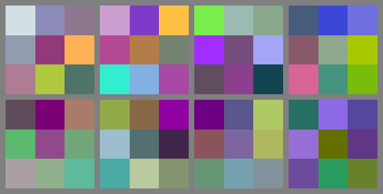

# Malaria Cell Classifier

A neural network that tells malaria-infected red blood cells from healthy ones,
built from scratch in NumPy with no machine learning library. I wrote the forward
pass, the loss, backpropagation, convolution, pooling and the training loop by
hand as a way to learn how neural networks work.

## Results

Each model is scored on cell images it never saw during training.

| Model | Accuracy on unseen images |
| --- | --- |
| Single neuron (logistic regression) | 62.7% |
| One hidden layer, raw pixels | 60.0% |
| + centred inputs | 66.0% |
| + 10,000 images | 70.5% |
| + mini-batch training | 71.7% |
| Convolution layer with max pooling | 79.4% |
| + 24,000 images | 83.8% |

The last two rows are validation accuracy. From that point on, a separate test
set is held back and will be used once, for a final score, after all the
settings have been chosen. Earlier rows were measured on a test set that was
also used to compare experiments, so they are slightly optimistic.

## What the networks learned

### Dense network

Each tile shows how training changed one hidden neuron's weights. The network
found the round cell region by itself and learned to respond to the purple stain
of the parasite.


Every neuron is a soft blob over the whole cell, not a small dot detector. A
dense network needs separate weights for every position, so it cannot learn
"a dot anywhere". That is the limit convolution removes.

### Convolutional network

Each tile is one filter: a 3 x 3 window of weights that slides across the whole
image. The same purple-against-green contrast appears, now as small local
patterns that can be detected at any position in the cell.



## How it works

- `data_loader.py` loads the images, resizes them to 32 x 32, and scales the pixels.
- `model.py` holds a single neuron: sigmoid, loss, gradients and accuracy.
- `network.py` holds the dense network: parameters, forward pass and backpropagation.
- `conv.py` holds the convolution layer: filters, max pooling, and their backpropagation.
- `train.py` trains the single neuron.
- `train_network.py` trains the dense network with mini-batch gradient descent.
- `train_conv.py` trains the convolutional network, with learning rate decay and
  a validation set.
- `visualise.py` turns learned weights into pictures.

## Running it

1. Download the cell images from the
   [NLM malaria data page](https://lhncbc.nlm.nih.gov/LHC-research/LHC-projects/image-processing/malaria-datasheet.html)
   (the link named NLM-Falciparum-Thin-Cell-Images) and extract them so the
   images sit in `data/cell_images/Parasitized` and `data/cell_images/Uninfected`.
2. Create a virtual environment and install the packages:

   ```
   python -m venv .venv
   .venv\Scripts\Activate.ps1
   pip install -r requirements.txt
   ```

3. Train the convolutional network:

   ```
   python train_conv.py
   ```

## Data

The images come from the US National Library of Medicine's malaria dataset:
27,558 single-cell images from thin blood smears, half parasitized and half
uninfected.

## Next steps

- Add a second convolution layer so filters can combine small patterns into larger ones.
- Draw feature maps to show where each filter fires on a cell.
- Report a final score on the held-back test set.